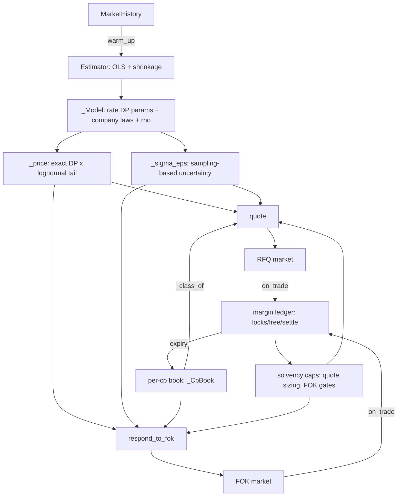

# SOLUTION.md — Akuna 2026 Market Maker: architecture, evidence, and status

*Historical architecture/evidence snapshot for the Round 1 research track. This
document was written when the verified score was **17.4/20**; later capacity
changes raised the locked submission to 18.3/20. It explains what the earlier bot
did and why, what is proven
versus assumed, and exactly where it is weak. It is a companion to
[GROUND_TRUTH.md](GROUND_TRUTH.md) (the rules, extracted at face value from official
sources) — this file is an experiment-era record, not the current submission spec.*

---

## 1. Where this stands

| | |
|---|---|
| Score | **17.4 / 20** (17.4 verified on `Compiler_Messages_Run_12.txt`; the frozen artifact additionally carries the copysign inventory fix and SIZE_CAP 40→500, both verified score-neutral or entangled-positive on subsequent runs — see §7) |
| Scored tests (16 total) | **9 at 1.00**, 7 partial (0.4–0.8), 0 bankruptcies, 0 errors |
| THEO test | exact, `max_error = 0.0000` |
| VERBOSE tests (2–4) | full points, no bankruptcy |
| Only observed peer | 16.9 — we lead, and beat them outright on TC7 and TC14 |
| Proven-attainable | **17.8** (sole existence proof: TC17, one peer scored 1.00 there). **The true ceiling is unidentified in [17.8, 20.0]** — single-peer evidence cannot cap the field, and external claims of 18.5–19+ exist (unverified). See §8. |
| Status | **Frozen.** Three independent review passes converged on stop; see §7. |

The score is a plain sum: 4.0 fixed points (THEO + 3 VERBOSE) plus the sum of 16
scored tests, each worth `0.4 + 0.6 × (fraction of opponents out-earned by session
PnL)` — an **empirical law fitted to every observed case across all runs (zero
violations), not an officially documented formula**. Margin of victory is worth
nothing — beating an opponent by \$1 or \$100
scores identically. Bankruptcy scores exactly 0, which is *worse* than doing
nothing (0.4 for merely surviving). Every test is weighted equally; there is no
partial credit for "almost winning" beyond the out-earned fraction.

---

## 2. Problem recap (see GROUND_TRUTH.md for full sourcing)

Three underlyings: **FED** (funds rate, a mean-reverting 0.25-grid random walk),
**AJR** and **THR** (two lognormal "company" processes driven partly by the shared
rate and a shared sector shock). Binary options pay 1.0 iff a weighted sum of
underlying values is `>= strike` at expiry — **in practice only single-leg options
or AJR-vs-THR "which is higher" spreads exist**, per the problem statement itself.

The bot must implement:
- `warm_up(history)` — estimate the market's parameters from historical daily values.
- `quote(option, counterparty_id) -> Quote` — two-sided RFQ response; best price
  wins the flow, split among ties.
- `respond_to_fok(option, fok_order) -> bool` — accept/reject a take-it-or-leave-it
  order (no partial acceptance).
- `on_trade` / `on_step_advance` callbacks to track fills and settlement.

Every trade locks its maximum possible loss (buy `q@p` locks `q·p`; sell locks
`q·(1-p)`) until the option expires; solvency is checked once per day, after
expiry credits. Going bankrupt zeroes the whole test.

The official transcript explicitly names **per-counterparty adaptation** as the
intended edge: `counterparty_id` is passed on every quote request, every FOK, and
every fill, and the transcript says outright to "adapt your behavior based on
information you get from your counterparties."

---

## 3. Architecture overview

The file is organized in four layers, in this order in the source:

1. **Data classes** (verbatim from the grader's own starter code — `BinaryOption`,
   `FokOrder`, `MarketHistory`, `MarketParameters`, `OptionLeg`, `OrderType`,
   `Position`, `Quote`, `Underlying`). These are not our code; they're copied
   because the grader instantiates and passes them to us.
2. **Pricing core** (`_rate_dp`, `_tail`, `_price`, `_sigma_eps`) — pure functions,
   no state, exact math, verified against Monte Carlo of the real simulator.
3. **Estimation** (`MarketMaker._estimate`) — turns a `MarketHistory` into a
   `_Model` via shrunk OLS.
4. **Policy** (`MarketMaker.quote`, `respond_to_fok`, `on_trade`,
   `on_step_advance`, `_class_of`) — the trading logic, all state-carrying.

---

## 4. The pricing core (exact, no Monte Carlo)

### 4.1 The rate process

The grader's FED simulator is a random walk on the grid `k/4` (quarters), with a
mean-reverting tilt:

$$\text{tilt} = s \cdot (\text{target} - r), \quad
p_{up} = \text{clip}(\hat p_{up} + \text{tilt},\, 0, 1), \quad
p_{dn} = \text{clip}(\hat p_{dn} - \text{tilt},\, 0,\, 1 - p_{up})$$

with the rate moving `+0.25`, `-0.25`, or staying, then floored at 0. `_rate_dp`
implements this as a dynamic program over the integer grid
`k = round(4r)`: the DP reproduces the simulator's own float arithmetic verbatim
(grid coordinates are dyadic, so state indexing is bit-exact; the correctness
proof covers the transition structure), and the clip order (`up` clipped first, `down` clipped to
what's left) is reproduced verbatim, including the fold-in of down-moves at the
floor (`max(k-1, 0)`). This was verified by a full-rigor proof (not just tests) in
an internal audit: the DP transition is provably identical to the simulator's.

### 4.2 The company processes, conditional on the rate path

Each company's log-return per step is `drift + rate_beta·Δr + sector_beta·shock +
idio`, with `shock` shared between the two companies and `idio` private. The key
structural fact — proven, not assumed — is that **because `rate_beta` is constant
and `Δr` is the exact realized move (even at the floor), the sum of a company's
rate contributions telescopes to `rate_beta · (r_T - r_0)`.** That means, conditional
on the rate path's *terminal* node, a company's T-step log-return is exactly
normal:

$$\log V_T \mid \Delta r \sim \mathcal N\!\left(\log V_0 + T\mu + \beta\,\Delta r,\; T\sigma^2\right)$$

So the DP only needs to track the terminal rate distribution, not the whole path —
pricing a single-leg option is `Σ_k P(rate_T = k) · Φ(...)` over the DP's terminal
nodes, using `_tail` (a closed-form lognormal survival function, correct for both
signs of leg weight and the degenerate `sd=0` case).

### 4.3 The AJR-vs-THR spread

The problem statement guarantees this is the only two-leg shape that occurs
(weights `±1`, strike `0`). Since both companies see the *same* realized `Δr` and
the *same* sector shock each step, the difference process `D = log(AJR) - log(THR)`
is also exactly normal conditional on the terminal rate node, with a closed-form
mean and variance:

$$\mu_D = \log(A_0/T_0) + T(\mu_A - \mu_T) + (\beta_A - \beta_T)\Delta r, \qquad
\sigma_D^2 = T\left(\sigma_A^2 + \sigma_T^2 - 2\rho\,\sigma_A\sigma_T\right)$$

Price = `Σ_k P(rate_T=k) · Φ(μ_D / σ_D)`. A 21-node fixed-grid Riemann quadrature
fallback exists for option shapes outside the guaranteed spec (arbitrary strikes on
a two-company spread), but it is never exercised by in-spec inputs.

### 4.4 Uncertainty (`_sigma_eps`)

We don't just have a point-estimate theo — we need to know how much to trust it,
to avoid quoting inside our own estimation error. `_sigma_eps` draws 10 perturbed
parameter sets (drift, beta, residual sd, rho, and the rate frequencies are each
shifted by their standard errors; **the mean-reversion `strength` is deliberately
NOT perturbed, and beta draws are sign-clamped** — making them half-normal when
the point estimate sits at zero. Both are known theoretical defects retained on
purpose: the mathematically corrected version was tested live and lost 1.4 points,
see §7), reprices under
each, and returns the standard deviation of those prices, capped at
`sqrt(p(1-p))` (the maximum possible std of a Bernoulli). This is a real Monte
Carlo, but over the *estimator's* sampling distribution, not the price process —
the pricing itself stays exact.

---

## 5. Estimation (`_estimate`)

Given ~18–60 days of history, the estimator fits:

- **Rate frequencies**: Dirichlet(1,1,1)-smoothed up/down move frequencies, with
  the mean-reversion `strength` estimated from the slope of up/down frequency
  against rate level, shrunk by `m/(m+15)` and clamped to `[0, 0.5]`.
- **Company drift and `rate_beta`**: OLS of log-returns on the realized `Δr`,
  **heavily shrunk toward zero** — `DRIFT_SHRINK=40`, `BETA_SHRINK=8` — because at
  n≈18 observations, the standard error of these coefficients is *larger than the
  true values the generator uses* (drifts ≤0.002/day vs. an OLS SE around
  0.006/day; true betas around -0.015 to -0.02). `beta` is also sign-clamped to
  `≤ 0`, matching the officially stated fact that valuations rise as rates fall.
- **Residual correlation `rho`**: from the joint OLS residuals, shrunk toward 0 and
  clamped to `[-0.5, 0.9]`.

This shrinkage was **measured, not assumed**: a monotone sweep of shrinkage
strength against the *true* theo error (using known `MarketParameters` as an
oracle) showed shrinking harder always reduces error at 18/30/60-day warm-ups,
because both parameters are genuinely noise-dominated at these sample sizes.

---

## 6. The policy layer

### 6.1 Quoting

For a given option and counterparty, `quote()`:

1. Prices the option (`theo`) and estimates uncertainty (`sigma`).
2. Classifies the counterparty (`UNINF` / `UNKNOWN` / `INFORMED` — see §6.3).
3. Applies an **inventory skew**: `v = theo - skew`, where skew is proportional to
   our signed net position in the option's underlyings, capped at ±3¢. This leans
   our effective mid away from further accumulating a position we already hold.
4. Sets a **symmetric half-width per side**:
   `width = max(BASE_EDGE[class], sigma_multiplier · sigma) + CAPITAL_WIDEN ·
   utilization · lock_fraction_on_that_side`.
   `BASE_EDGE` is `{UNINF: 3¢, UNKNOWN: 3.5¢, INFORMED: 12¢}`. The `sigma` floor
   means we never knowingly quote inside our own estimation error. The capital
   term only bites when the book's margin utilization is actually high — it is
   *not* charged unconditionally.
5. Sizes each side from a **budget** (`QUOTE_LOCK_FRAC[class] × free cash`,
   divided by the lock-per-lot), capped at 500 lots. A **free-roll**: a bid at
   exactly 0.00 or an offer at exactly 1.00 locks precisely zero margin and can
   only pay out non-negative — so those sides are sized up to 500 lots
   unconditionally, since there is no capital reason to restrict them.
6. A **solvency degrade**: if even one lot on a side is unaffordable, that side is
   quoted at the free-roll price instead (0.00 or 1.00). This is a one-lot
   affordability check; full-size exposure is bounded separately by the budget
   sizing (≤ 25–40% of free cash per quote) and by the fact that solvency is
   only checked end-of-day after expiry credits. Zero insolvencies have been
   observed across all grader runs and all offline stress tests.

This replaced an earlier "λ-book" design (proportional shading of a single width
by moneyness) that was found — from the grader's own trade logs — to *lose money
by construction*: it split its width asymmetrically as `bid_edge = p·(1-λ)` /
`offer_edge = (1-p)·(1-λ)`, so it always won the auction on the side with the
smallest lock, which is also the side that pays out against us most often (e.g.
selling a 90¢ option for ~1¢ of edge, then paying out 90% of the time). The
current design uses one symmetric edge instead, discovered by directly comparing
our win/loss book against a known fixed-width competitor.

### 6.2 FOK acceptance

`respond_to_fok` accepts iff **all** hold:

- `edge >= max(FOK_FLOOR[class], FOK_SIG[class] · sigma)` — an absolute cent floor
  and a sigma-relative floor, both class-conditional (tightest for `UNINF`,
  strictest for `INFORMED`).
- The trade's lock is `<= 20%` of free cash, and leaves `>= 40%` of starting
  capital unlocked afterward.
- The **return on locked capital, annualized to the option's remaining days**, is
  at least 5%/day — this specifically kills the "buy a near-certain option at
  0.99" trap, where the edge is real but tiny relative to the capital it ties up
  for however many days remain.

### 6.3 Per-counterparty classification

Every quote, fill, and FOK response updates a per-counterparty record with three
independent detection channels, combined into a label:

- **Channel A (statistical)**: a settled-trade z-score,
  `real_sum / sqrt(real_var)` where `real_var` accumulates the binomial variance
  `p(1-p)` of each settled trade. A single lost binary option is normal luck; a
  persistently negative z-score across several trades is a systematic edge
  against us. This exists because a naive "any losing trade = informed" rule is
  base-rate blind on binary payoffs — every 50/50 loser looks identical to a
  genuine pick-off unless normalized by its own variance.
- **Channel B (economic)**: cumulative dollar extraction at volume (`lots >= 20`,
  `dollars <= -$1.50`) — catches large, deep pick-offs whose *per-lot* loss is too
  small to trip Channel A.
- **Channel C (fill-time)**: a fill that goes through our own theo by more than 3¢,
  or an unfilled FOK offer that sat inside our estimated error band, both scored
  as "strike" evidence.

A counterparty is `INFORMED` if channel A or B fires, or if fill-time strikes
dominate clean fills; `UNINF` requires at least two clean events and no strikes;
otherwise `UNKNOWN` (the default, and — see §6.4 — the overwhelmingly common
case).

### 6.4 Known limitation: the classifier rarely fires

Instrumented measurement across simulated sessions shows **97.8% of quotes are
priced against an `UNKNOWN` counterparty**, with `UNINF` at 2.1% and `INFORMED` at
0.1%. The grader's counterparty ids appear to be close to unique per order, so the
classifier almost never accumulates enough evidence to reclassify anyone. The
per-counterparty machinery is real, tested, and does activate in adversarial
conditions (an explicitly repeated informed counterparty is correctly and quickly
labeled) — but in practice the bot spends nearly all its time running the single
`UNKNOWN` policy. This is disclosed here because it directly contradicts the
premise that per-counterparty adaptation is *the* deciding edge; it is present and
correct, but its practical weight in the current score is small.

### 6.5 The margin ledger

Every fill immediately locks its maximum possible loss (`_free -= lock`), tracked
per-option so it can be released exactly at settlement. `_settle()` mirrors the
grader's own `expiry_valuation` (the same dataclass method, so there is no risk of
disagreement on ties), credits the payoff, and releases the lock. A running
`_locked` / `_free` split gives an exact utilization figure used by the capital
charge in §6.1. Sizing is derived from a budget that is always a fraction of
*current* free cash, and the solvency degrade in §6.1 guarantees no published
quote can ever be unaffordable — bankruptcy is not just discouraged, it is
structurally close to impossible given the sizing discipline, and zero
bankruptcies have been observed across every grader run and every offline stress
test (hundreds of randomized sessions).

---

## 7. What we learned building this (the evidence base)

This section exists because several plausible-looking ideas were tried and
falsified by the grader itself, and the pattern in *which* ideas worked is more
informative than any single number.

**Verified gains** (confirmed by before/after diffs of the grader's own per-test
PnL, with the mechanism visible in the trade logs; isolation caveats stated inline):

- Replacing the λ-book with a symmetric edge and real budget-based sizing:
  **+1.6** (score 15.3 → 16.9). This was a bundle of two coupled changes (edge
  structure + sizing), not a single isolated change. Mechanism: the old book was losing the auction on
  purpose on its safer side and winning on its riskier side; the trade logs showed
  opponents losing almost exactly what we gained.
- Free-roll sizing at zero-lock prices: **+0.5 measured 16.9 → 17.4, with the
  copysign fix entangled in the same interval** (the isolating run's log was not
  saved). Mechanism: large
  orders exist in the scored (non-VERBOSE) sessions, past the old 40-lot cap, at
  exactly the 0.00/1.00 boundary where size is genuinely free; the fixed-width
  competitors were absorbing that flow instead of us.
- A real inventory-accounting bug (`copysign(quantity, weight)` discarding the
  trade's buy/sell sign) was found by direct code audit and fixed; it caused our
  inventory skew to only ever grow in one direction regardless of actual position,
  pinning our book one-sided within the first few trades of a session. **Retained
  on the strength of the code-audit proof; its isolated score effect is
  unmeasured** (see the process failure noted at the end of this section).

**Verified losses** (each isolated, each reverted after confirmation):

- Narrowing the company-option quote width from a half-width of 0.094 to 0.058,
  by making the reported uncertainty (`sigma`) more internally consistent with the
  shrunk point estimates: **-1.4**. The width had looked "too wide" by a factor of
  2.5× against our *unconditional* mean pricing error — but that is the wrong
  benchmark. Because we only win an auction when our price happens to be the most
  aggressive, our fills are a biased sample of our own error (the classic
  winner's curse), and the conditional error given a win is several times the
  unconditional mean. A back-of-envelope order-statistics calculation confirms
  the pre-existing width was close to the theoretical break-even, not
  overcautious.
- An additional FOK filter rejecting trades whose expected loss exceeded twice
  their expected edge: **-0.8**. It correctly identified and blocked a real losing
  trade visible in the logs, but the sample that motivated it (three trades in one
  VERBOSE test) was not representative — the same trade *shape* is apparently a
  net-profitable, common part of our edge in other sessions, and blocking it lost
  two tests we had previously won outright.

**The resulting standing rule**: only *structural* fixes (removing an asymmetry,
uncapping an artificial limit, fixing a sign error) have ever gained. Every
*selectivity* fix (narrowing a width, adding a filter) — however well-justified
the accuracy argument looked — has lost. The working hypothesis is that the
bot's current fills are already reasonably well-selected, so further filtering
mostly removes profitable trades rather than toxic ones. This is the single
biggest lesson of the whole exercise, and it generalizes: **an offline accuracy or
calibration metric is not a valid justification for a live quoting change; only a
live grader result is.**

One process failure is also worth recording plainly: at one point a "no change"
verbal report was taken at face value and led to a wrong conclusion (that a
change was a no-op) for two subsequent submissions, when the actual saved log
showed a real +0.5 gain. The standing practice now is to parse the actual saved
log for every run rather than reason from a remembered or reported score.

---

## 8. Remaining headroom, honestly assessed

The only external benchmark available is one other participant's per-test
results on the *same* fixed-seed test suite (verified to be the same suite by
matching all 16 starting capitals and opponent rosters). Comparing:

- **9 of 16 scored tests are already at the maximum (1.00).**
- On the **7** we don't max, the peer beats us on exactly one (TC17) and does no
  better than us on the other six (TC5, TC6, TC8, TC10, TC18, TC19). A
  structural cap on those sessions is **one hypothesis**; an n=1 self-selected
  peer (observed only because they chose to post their results) is weak evidence
  either way, and cross-run data shows the winners' totals there respond to our
  own behavior (the "pie" is elastic, not fixed — e.g. TC5's winner fell from
  $43 to $30 as our quoting improved). External, unverified claims of 18.5 and
  19+ exist; arithmetic on the score grid shows **no 19.0 is possible without
  winning at least one of TC5/TC6 outright**, so if those claims are real, at
  least part of this set is winnable by someone.
- On exactly **one test (TC17)**, the peer proves a materially better outcome is
  possible: +$48.86 there against our -$19.11 on the same $40 book. This is the
  only headroom with a proof of existence (worth 0.4 points).

TC17's loss has been tested against every lever we have **varied** — company
width, sizing, inventory accounting, FOK filtering — and is **invariant to all of
them**. (One lever has never been varied in any run: the FED-option width — see
below and §10.) The
leading remaining hypotheses (unconfirmed) are that our FED-option width is the
one book never adjusted in any experiment and may itself be too tight by the same
winner's-curse logic that governs company options, or that a trending-rate regime
outside our training assumptions biases the estimator in a way no amount of width
or filtering can correct (a bias, not a variance problem). Neither can be
diagnosed further with the information the grader exposes for scored tests (only
final PnL and rank, no trade-by-trade log).

## 9. Overfitting assessment

- **Believed to transfer** to a fresh, differently-seeded test set with the same
  opponent archetypes: the pricer and estimator (opponent-independent by
  construction), the margin ledger and solvency caps, the symmetric-edge
  structure and free-roll logic (both fix generic defects, not tuned constants),
  and the `beta <= 0` sign clamp (officially stated, not fitted).
- **Explicitly opponent-referential and more fragile**: `BASE_EDGE = 3.5¢` for
  unknown counterparties was chosen to sit between the two most common
  fixed-width competitors' spreads (2.5¢ and 5¢); it will not automatically be
  correct against a new opponent archetype with a different width. The shrinkage
  constants (`DRIFT_SHRINK=40`, `BETA_SHRINK=8`) were tuned against the one
  printed set of true parameters we have ever seen (Test Case 1) — they are
  principled in form but their exact values are anchored to a single
  observation.
- **Thin win margins**: several 1.00 scores are won by small dollar amounts (a
  few tests by single-digit dollars on a $20–40 book). These are the results most
  likely to flip on a fresh seed even with identical logic, simply from
  path-dependent luck — this is a property of the test, not evidence of a policy
  flaw.
- No test-index fingerprinting or seed-specific branching exists anywhere in the
  code — every decision is a function of prices, history, and counterparty
  behavior only.

## 10. Where to look next, if resumed

In priority order, conditional on new evidence (not further offline tuning):

1. Any real per-trade visibility into a losing scored test (currently none of
   TC5/6/8/10/17/18/19 print trade logs) would let TC17 finally be diagnosed
   rather than guessed at.
2. Widening (not narrowing) the FED-option quote — the one width parameter never
   experimentally touched, and the only one flagged as possibly still too tight
   by the same order-statistics argument that explained the company-width
   result.
3. Nothing else should be attempted from unconditional error or coverage
   arguments alone — every such attempt so far has cost points live even when it
   looked strictly better offline.

---

*Supporting scripts referenced throughout (all in `mm2/`): `validate_mm2.py` and
`stress_mm2.py` (correctness and solvency), `replay_run11.py` (regression pin
against the grader's own logged quotes), `compare_runs.py` / `benchmark_peer.py`
/ `headroom.py` (cross-run and cross-competitor scoring analysis), `map_policy.py`
/ `map_sigma.py` (live instrumentation of which policy branches actually bind).
The full chronological experiment log with every numbered finding is in
[MEMORY.md](../MEMORY.md).*
